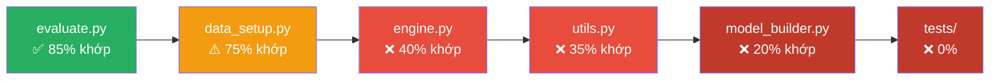

# 📋 Báo cáo Phân tích: Đặc tả Thiết kế vs Code Hiện tại — Lab 2

> **Ngày:** 2026-11-04
> **Mục đích:** Đối chiếu từng module code hiện tại với tài liệu đặc tả trong `docs/define&designt/`, xác định các điểm **đã bám theo thiết kế** và **chưa đáp ứng / sai hướng** cần tái cấu trúc.

---

## 1. Tổng quan Lab 2

Lab 2 yêu cầu xây dựng quy trình **Transfer Learning** hoàn chỉnh trên CIFAR-10, sử dụng VGG16 và ResNet-18 pre-trained từ ImageNet. Hệ thống thiết kế theo kiến trúc **modular** (`going_modular/`) với 5 module + notebook điều phối, đi kèm 6 thí nghiệm có cấu hình riêng.

### Cấu trúc thư mục thiết kế vs thực tế

| Thành phần | Thiết kế (doc `00`) | Hiện tại | Trạng thái |
| :--- | :--- | :--- | :--- |
| `going_modular/__init__.py` | ✅ | ✅ Có | ⚠️ API không khớp |
| `going_modular/data_setup.py` | ✅ | ✅ Có | ⚠️ Thiếu tính năng |
| `going_modular/model_builder.py` | ✅ | ✅ Có | ❌ Sai kiến trúc |
| `going_modular/engine.py` | ✅ | ✅ Có | ❌ Thiếu nhiều tính năng |
| `going_modular/evaluate.py` | ✅ | ✅ Có | ✅ Tốt, thiếu ít |
| `going_modular/utils.py` | ✅ | ✅ Có | ❌ Thiếu nhiều tính năng |
| `tests/` | ✅ Cần 6 file test | ❌ Không có | ❌ Chưa tạo |
| `notebooks/pretrained_models.ipynb` | ✅ | ✅ Có | Chưa đối chiếu |
| `artifacts/` | ✅ Cần 6 thư mục run | Chưa rõ | — |
| `requirements.txt` | ✅ | ✅ Có | ⚠️ Có `torchinfo` thừa, thiếu `numpy`, `pillow`, `pytest` |

---

## 2. Phân tích Chi tiết từng Module

### 2.1. `model_builder.py` — ❌ SAI HƯỚNG NGHIÊM TRỌNG

> [!CAUTION]
> Module này **sai kiến trúc hoàn toàn** so với đặc tả `02_model.md`. Đây là điểm cần refactor lớn nhất.

**Đặc tả yêu cầu:**
- `ModelConfig` dataclass (frozen) để quản lý cấu hình mô hình
- Registry-based architecture (`ARCH_SPECS`) với `get_head`, `set_head`, `blocks`
- `build_model(cfg: ModelConfig) -> nn.Module` factory nhận config
- `get_transforms(cfg, weights=None)` để lấy transform từ weights
- `set_train_mode(model, cfg)` để giữ BN frozen ở eval
- `get_param_groups(model, cfg, lr_head, lr_backbone)` cho optimizer 2 giai đoạn
- `count_params(model) -> {total, trainable, frozen}`
- `describe_model(model)` / `format_model_summary(model)` cho Step 3
- `unfreeze_last_n` logic cho Fine-Tuning
- Validation cấu hình: kiến trúc lạ, dropout, kết hợp cờ mâu thuẫn

**Code hiện tại (107 dòng) — Vấn đề:**

| # | Vấn đề | Mức độ |
| :--- | :--- | :--- |
| 1 | **Dùng class wrapper** (`CIFAR10ModelV0`, `CIFAR10ModelV1`) thay vì registry + factory config-driven | ❌ Sai kiến trúc |
| 2 | **Không có `ModelConfig`** dataclass | ❌ Thiếu hoàn toàn |
| 3 | **`build_model` nhận tham số rời** (`name`, `num_classes`, `freeze_backbone`, `pretrained`) thay vì `ModelConfig` | ❌ Sai API |
| 4 | Dùng tên model `"v0"`, `"v1"` thay vì `"vgg16"`, `"resnet18"` | ❌ Sai quy ước |
| 5 | **Không có `get_transforms`** | ❌ Thiếu |
| 6 | **Không có `set_train_mode`** để giữ BN frozen | ❌ Thiếu |
| 7 | **Không có `get_param_groups`** cho 2 learning rate | ❌ Thiếu |
| 8 | **Không có `unfreeze_last_n`** cho Fine-Tuning | ❌ Thiếu |
| 9 | **Không có `count_params`** (chỉ có `count_trainable_params` và `count_total_params` riêng lẻ) | ⚠️ Gần đúng |
| 10 | **Không có `describe_model`**, `format_model_summary` | ❌ Thiếu |
| 11 | **Không có validation** cấu hình (`dropout`, `freeze_backbone=False + unfreeze_last_n>0`) | ❌ Thiếu |
| 12 | Không hỗ trợ `to_dict()` / `from_dict()` để serialize config | ❌ Thiếu |
| 13 | ResNet-18 freeze logic: dùng `if "fc" not in name` thay vì freeze toàn bộ rồi thay head | ⚠️ Hoạt động nhưng sai thứ tự thiết kế |

**Điểm đúng:**
- ✅ Dùng `IMAGENET1K_V1` weights thay vì `pretrained=True` deprecated
- ✅ VGG16 thay `classifier[-1]`, ResNet-18 thay `model.fc`
- ✅ Freeze backbone logic cơ bản hoạt động

---

### 2.2. `data_setup.py` — ⚠️ GẦN ĐÚNG, THIẾU TÍNH NĂNG NHỎ

**Đặc tả yêu cầu (`01_data.md`):**

| # | Yêu cầu | Hiện tại | Trạng thái |
| :--- | :--- | :--- | :--- |
| 1 | `get_pretrained_transform(augment, model_name)` | ✅ Có, đúng API | ✅ |
| 2 | `stratified_split_indices(labels, val_size, seed)` | ✅ Có, đúng thuật toán | ✅ |
| 3 | `_TransformSubset` wrapper | ✅ Có, đúng thiết kế | ✅ |
| 4 | `create_train_val_test_dataloaders(...)` | ⚠️ Có nhưng thiếu `generator` param | ⚠️ |
| 5 | `generator` param cho Train DataLoader shuffle | ❌ Thiếu trong signature và logic | ❌ |
| 6 | Augmentation mặc định khi `train_transform=None` | ❌ Gọi `augment=False` thay vì `augment=True` | ❌ |
| 7 | `pin_memory = torch.cuda.is_available()` | ✅ Đúng | ✅ |
| 8 | `download` parameter | ✅ Có | ✅ |
| 9 | Input validation (`ValueError`) | ✅ Có | ✅ |
| 10 | `num_workers=0` default | ✅ Đúng | ✅ |

**Vấn đề cụ thể:**

1. **Thiếu `generator` parameter** (dòng 137-147): Đặc tả yêu cầu `generator: Optional[torch.Generator] = None` để Notebook truyền generator riêng cho thứ tự shuffle mỗi run, nhưng code không có.

2. **Fallback transform không augment** (dòng 155-158): Khi `train_transform=None`, code gọi `get_pretrained_transform(augment=False)` — thiếu augmentation cho tập Train. Đặc tả nói fallback nên dùng `augment=True` cho Train.

---

### 2.3. `engine.py` — ❌ THIẾU NHIỀU TÍNH NĂNG THIẾT KẾ

**Đặc tả yêu cầu (`03_engine.md`):**

| # | Yêu cầu | Hiện tại | Trạng thái |
| :--- | :--- | :--- | :--- |
| 1 | `train_step` trung bình có trọng số theo số mẫu | ✅ Đúng | ✅ |
| 2 | `evaluate_step` dùng `inference_mode` | ✅ Đúng | ✅ |
| 3 | `train_mode_fn` thay vì gọi trực tiếp `model.train()` | ❌ Dùng `frozen_backbone` param thay thế | ❌ Sai cách tiếp cận |
| 4 | `start_epoch` cho TensorBoard offset | ❌ Thiếu (TensorBoard step bắt đầu từ 0) | ❌ |
| 5 | `save_path` → `best_model.pth` | ✅ Có (`checkpoint_path`) | ✅ |
| 6 | `monitor` chọn `val_acc` hoặc `val_loss` | ❌ Chỉ hardcode `val_acc` | ❌ |
| 7 | `restore_best` nạp lại trọng số tốt nhất | ⚠️ Có nhưng không là tham số boolean | ⚠️ |
| 8 | `checkpoint_dir` / `resume` cho resume training | ❌ Thiếu hoàn toàn | ❌ |
| 9 | History có `lr` (learning rate mỗi epoch) | ❌ Thiếu | ❌ |
| 10 | History có `epoch_time` | ❌ Thiếu | ❌ |
| 11 | TensorBoard ghi `LR/group_<i>` | ❌ Thiếu | ❌ |
| 12 | TensorBoard dùng `add_scalar` riêng cho từng tag | ❌ Dùng `add_scalars` (gộp) | ⚠️ |
| 13 | Ghi history nguyên tử sau mỗi epoch | ❌ Thiếu | ❌ |
| 14 | `engine.py` không phụ thuộc `ModelConfig` | ✅ Đúng (dùng param) | ✅ |
| 15 | Validate epochs > 0, start_epoch >= 0, monitor hợp lệ | ⚠️ Chỉ validate epochs | ⚠️ |

**Vấn đề cụ thể:**

1. **`frozen_backbone` approach** (dòng 19-23): Đặc tả yêu cầu nhận `train_mode_fn` callback từ `functools.partial(set_train_mode, cfg=...)`. Code hiện tại nhận `frozen_backbone: Optional[nn.Module]` rồi gọi `.eval()` trên đó — hoạt động được nhưng coupling chặt và không linh hoạt.

2. **History thiếu 2 keys quan trọng**: `lr` (LR của optimizer mỗi epoch) và `epoch_time` (thời gian epoch). Đặc tả yêu cầu 6 keys, code chỉ có 4.

3. **Không hỗ trợ 2 giai đoạn**: Thiếu `start_epoch`, nên Fine-Tuning sẽ bị chồng TensorBoard step lên Giai đoạn 1.

4. **Không có resume**: Không lưu/nạp `last_checkpoint.pth`.

---

### 2.4. `utils.py` — ❌ THIẾU NHIỀU TÍNH NĂNG

**Đặc tả yêu cầu (`04_utils.md`):**

| # | Yêu cầu | Hiện tại | Trạng thái |
| :--- | :--- | :--- | :--- |
| 1 | `set_seed(seed, deterministic)` | ⚠️ Có nhưng thiếu `numpy`, thiếu `deterministic` flag | ⚠️ |
| 2 | `get_device(prefer=None)` → `torch.device` | ❌ Trả `str`, không nhận `prefer`, không validate | ❌ |
| 3 | `get_env_info(device)` | ❌ Thiếu hoàn toàn | ❌ |
| 4 | `create_writer(experiment_name)` | ❌ Thiếu hoàn toàn | ❌ |
| 5 | `save_model(model, path)` — đơn giản | ⚠️ Có nhưng API khác (nhận `target_dir` + `model_name`) | ⚠️ |
| 6 | `load_model(model, path, device)` | ✅ Có, đúng | ✅ |
| 7 | `save_config(artifact_dir, config)` riêng | ❌ Chỉ có `save_training_metadata` gộp | ⚠️ |
| 8 | `save_history(artifact_dir, history)` riêng | ❌ Chỉ có `save_training_metadata` gộp | ⚠️ |
| 9 | `load_experiment(artifact_dir)` | ✅ Có (`load_training_artifacts`) | ✅ |
| 10 | `artifacts_exist(artifact_dir) -> bool` | ❌ Thiếu | ❌ |
| 11 | `save_checkpoint` / `load_checkpoint` (resume) | ❌ Thiếu hoàn toàn | ❌ |
| 12 | `save_test_metrics` / `load_test_metrics` | ❌ Thiếu hoàn toàn | ❌ |
| 13 | Ghi file nguyên tử (atomic write) | ⚠️ Có trong `save_training_metadata` | ⚠️ |
| 14 | Validate schema history (6 keys) | ⚠️ Chỉ validate 4 keys (`HISTORY_KEYS` thiếu `lr`, `epoch_time`) | ⚠️ |
| 15 | `weights_only=True` khi load | ❌ Thiếu (dòng 100: không có `weights_only`) | ❌ |
| 16 | `accuracy_fn` — không thuộc đặc tả | ⚠️ Thừa, nên xóa | ⚠️ |
| 17 | `print_train_time` — không thuộc đặc tả | ⚠️ Thừa, nên xóa | ⚠️ |

---

### 2.5. `evaluate.py` — ✅ TỐT NHẤT, THIẾU ÍT

**Đặc tả yêu cầu (`05_evaluation_results.md`):**

| # | Yêu cầu | Hiện tại | Trạng thái |
| :--- | :--- | :--- | :--- |
| 1 | `InferenceResult` dataclass | ✅ Đúng | ✅ |
| 2 | `run_inference(model, dataloader, device, loss_fn)` | ✅ Đúng | ✅ |
| 3 | `predict_probs`, `predict_dataloader` | ✅ Có | ✅ |
| 4 | `compute_confusion_matrix(*, y_true, y_pred, num_classes)` keyword-only | ✅ Đúng | ✅ |
| 5 | `classification_metrics(cm)` | ✅ Đúng | ✅ |
| 6 | `wilson_interval(correct, total, z)` | ✅ Đúng | ✅ |
| 7 | `per_class_accuracy(cm)` | ✅ Có | ✅ |
| 8 | `top_confusions(cm, class_names, k)` — không liệt kê count=0 | ✅ Đúng | ✅ |
| 9 | `misclassified_indices(y_true, y_pred, logits, max_items)` | ✅ Đúng | ✅ |
| 10 | `denormalize(images, mean, std)` | ✅ Đúng | ✅ |
| 11 | `get_mean_std(transform)` | ⚠️ Có nhưng thiếu `transform_weights` param cho fallback ImageNet | ⚠️ |
| 12 | `measure_inference_time(...)` | ✅ Đúng, có CUDA sync | ✅ |
| 13 | `file_size_mb(path)` | ✅ Có | ✅ |
| 14 | `build_cost_record(...)` | ⚠️ Thiếu `source_history` cho `train_time_total_s` | ⚠️ |
| 15 | `evaluate_predictions(result, class_names)` | ✅ Có nhưng thiếu `predictions` (y_true, y_pred, confidence) | ⚠️ |
| 16 | `format_comparison_table(runs)` | ⚠️ Thiếu cột `Train time total (s)` | ⚠️ |
| 17 | `finalize_figure(fig, save_path, show, close)` | ✅ Đúng | ✅ |
| 18 | `plot_confusion_matrix` | ✅ Đúng | ✅ |
| 19 | `plot_per_class_accuracy` | ✅ Đúng | ✅ |
| 20 | `plot_sample_predictions` | ✅ Đúng | ✅ |
| 21 | `plot_history` với `start_epochs` | ✅ Đúng | ✅ |

**Vấn đề nhỏ:**
- `build_cost_record`: thiếu `source_history` param để tính `train_time_total_s` (Fine-tune = phase time + baseline time)
- `evaluate_predictions`: chưa trả về `predictions` block (y_true, y_pred, confidence) trong output dict
- `get_mean_std`: thiếu `transform_weights` param

---

### 2.6. `__init__.py` — ⚠️ API KHÔNG KHỚP ĐẶC TẢ

**Đặc tả (`00`, mục 2.8) yêu cầu xuất:**

```python
# Phải có theo đặc tả
ModelConfig, build_model, get_transforms, count_params,
describe_model, set_train_mode, get_param_groups,
create_train_val_test_dataloaders, train, evaluate_step,
set_seed, get_device, run_inference, evaluate_predictions
```

**Hiện tại xuất (đã có nhưng sai tên hoặc thừa):**

| Đặc tả yêu cầu | Hiện tại export | Trạng thái |
| :--- | :--- | :--- |
| `ModelConfig` | ❌ Không có | ❌ |
| `build_model` | `build_model` | ⚠️ Có nhưng API sai |
| `get_transforms` | ❌ Không có | ❌ |
| `count_params` | `count_trainable_params`, `count_total_params` | ⚠️ Tách riêng |
| `describe_model` | ❌ Không có | ❌ |
| `set_train_mode` | ❌ Không có | ❌ |
| `get_param_groups` | ❌ Không có | ❌ |
| `run_inference` | ❌ Không export (có trong evaluate.py) | ⚠️ |
| `evaluate_predictions` | ❌ Không export (có trong evaluate.py) | ⚠️ |
| — | `CIFAR10ModelV0`, `CIFAR10ModelV1` (thừa) | ⚠️ Thừa |
| — | `MODEL_NAMES` (thừa) | ⚠️ Thừa |
| — | `eval_model` (thừa) | ⚠️ Thừa |
| — | `accuracy_fn`, `print_train_time` (thừa) | ⚠️ Thừa |

---

### 2.7. Tests — ❌ THIẾU HOÀN TOÀN

Đặc tả yêu cầu **6 file test** và `conftest.py`:
- `tests/conftest.py` — marker `slow`, backend Agg
- `tests/test_data_setup.py` — D1-D7
- `tests/test_model_builder.py` — T1-T7
- `tests/test_engine.py` — E1-E10
- `tests/test_utils.py` — U1-U11
- `tests/test_evaluate.py` — V-series

**Hiện tại:** Không tồn tại thư mục `tests/`.

---

### 2.8. `requirements.txt` — ⚠️ THIẾU/THỪA

| Gói | Đặc tả | Hiện tại | Trạng thái |
| :--- | :--- | :--- | :--- |
| `torch` | ✅ | ✅ | ✅ |
| `torchvision` (≥ 0.14) | ✅ | ✅ | ✅ |
| `tensorboard` | ✅ | ✅ | ✅ |
| `matplotlib` | ✅ | ✅ | ✅ |
| `numpy` | ✅ | ❌ | ❌ Thiếu |
| `pillow` | ✅ | ❌ | ❌ Thiếu |
| `pytest` | ✅ | ❌ | ❌ Thiếu |
| `tqdm` | — | ✅ | ✅ OK |
| `torchinfo` | ❌ Đặc tả nói **không cần** | ✅ Có | ⚠️ Thừa |
| `pandas` | — | ✅ | ⚠️ Không rõ cần |

---

## 3. Bảng Tổng hợp Mức Độ Phù Hợp



| Module | Mức phù hợp | Ưu tiên refactor | Ghi chú |
| :--- | :--- | :--- | :--- |
| `model_builder.py` | **~20%** | 🔴 Phase 2 — Cao nhất | Sai kiến trúc hoàn toàn, cần viết lại |
| `utils.py` | **~35%** | 🔴 Phase 4 | Thiếu hầu hết API mới |
| `engine.py` | **~40%** | 🔴 Phase 5 | Thiếu resume, epoch_time, lr, start_epoch |
| `data_setup.py` | **~75%** | 🟡 Phase 3 | Bổ sung generator, sửa augment fallback |
| `evaluate.py` | **~85%** | 🟢 Phase 6 | Bổ sung nhỏ (source_history, predictions) |
| `__init__.py` | **~30%** | 🟡 Phase 7 | Cập nhật sau khi refactor các module |
| `tests/` | **0%** | 🔴 Mọi Phase | Chưa tạo |

---

## 4. Khuyến nghị Lộ trình Tái cấu trúc

> [!IMPORTANT]
> Theo đúng `06_implementation_plan.md`, triển khai theo thứ tự Phase, mỗi Phase có **cổng kiểm tra** trước khi sang Phase tiếp.

### Phase 1 — Hạ tầng
- Tạo `tests/conftest.py` (marker `slow`, backend `Agg`)
- Sửa `requirements.txt` (thêm `numpy`, `pillow`, `pytest`; bỏ `torchinfo`)
- Cập nhật `.gitignore` nếu cần

### Phase 2 — `model_builder.py` ← VIẾT LẠI
- Tạo `ModelConfig` dataclass
- Xây registry `ARCH_SPECS` cho VGG16 + ResNet-18
- Implement `build_model(cfg)`, `get_transforms`, `set_train_mode`, `get_param_groups`, `count_params`, `describe_model`
- Viết `tests/test_model_builder.py` (T1-T7)

### Phase 3 — `data_setup.py` ← SỬA NHỎ
- Thêm `generator` parameter vào factory
- Sửa fallback `augment=True` cho train_transform
- Viết `tests/test_data_setup.py` (D1-D7)

### Phase 4 — `utils.py` ← BỔ SUNG NHIỀU
- Sửa `set_seed`: thêm `numpy`, `deterministic` flag
- Sửa `get_device`: trả `torch.device`, thêm `prefer`
- Thêm `get_env_info`, `create_writer`
- Thêm `save_config`, `save_history` riêng, `artifacts_exist`
- Thêm `save_checkpoint`/`load_checkpoint`, `save_test_metrics`/`load_test_metrics`
- Thêm `weights_only=True`
- Xóa `accuracy_fn`, `print_train_time`
- Viết `tests/test_utils.py` (U1-U11)

### Phase 5 — `engine.py` ← REFACTOR LỚN
- Thêm `train_mode_fn` thay `frozen_backbone`
- Thêm `start_epoch`, `monitor`, `restore_best`, `checkpoint_dir`, `resume`
- History 6 keys: thêm `lr`, `epoch_time`
- TensorBoard: `add_scalar` riêng + LR tags + offset step
- Lưu checkpoint + history nguyên tử
- Viết `tests/test_engine.py` (E1-E10)

### Phase 6 — `evaluate.py` ← BỔ SUNG NHỎ
- `build_cost_record`: thêm `source_history`, tách `train_time_phase_s` / `train_time_total_s`
- `evaluate_predictions`: thêm `predictions` block
- `get_mean_std`: thêm `transform_weights` param
- `format_comparison_table`: thêm cột `Train time total`
- Viết `tests/test_evaluate.py`

### Phase 7 — Tích hợp
- Cập nhật `__init__.py` theo API mới
- Refactor notebook
- Smoke test end-to-end

---

## 5. Kết luận

> [!WARNING]
> Code hiện tại **hoạt động được** cho các thí nghiệm cơ bản, nhưng **không bám theo đặc tả thiết kế** ở nhiều điểm cốt lõi. Module `model_builder.py` cần viết lại hoàn toàn. Các module khác cần bổ sung tính năng quan trọng (resume, 2 giai đoạn, config-driven). **Tests chưa tồn tại** — đây là vi phạm lớn nhất so với quy trình Define → Design → Test → Implement.

Điểm tích cực: `evaluate.py` và `data_setup.py` đã bám khá sát thiết kế, chỉ cần bổ sung nhỏ. Phần logic tính toán cốt lõi (stratified split, confusion matrix, Wilson CI, inference) đã đúng.
