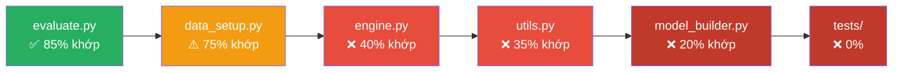

# 📋 Báo cáo Phân tích: Đặc tả Thiết kế vs Code Hiện tại — Lab 2

> **Ngày:** 2026-11-04
> **Mục đích:** Đối chiếu từng module code hiện tại với tài liệu đặc tả trong `docs/define&designt/`, xác định các điểm **đã bám theo thiết kế** và **chưa đáp ứng / sai hướng** cần tái cấu trúc.

---

## 1. Tổng quan Lab 2

Lab 2 yêu cầu xây dựng quy trình **Transfer Learning** hoàn chỉnh trên CIFAR-10, sử dụng VGG16 và ResNet-18 pre-trained từ ImageNet. Hệ thống thiết kế theo kiến trúc **modular** (`going_modular/`) với 5 module + notebook điều phối, đi kèm 6 thí nghiệm có cấu hình riêng.

### Cấu trúc thư mục thiết kế vs thực tế

| Thành phần | Thiết kế (doc `00`) | Hiện tại | Trạng thái |
| :--- | :--- | :--- | :--- |
| `going_modular/__init__.py` | ✅ | ✅ Có | ⚠️ API không khớp |
| `going_modular/data_setup.py` | ✅ | ✅ Có | ⚠️ Thiếu tính năng |
| `going_modular/model_builder.py` | ✅ | ✅ Có | ❌ Sai kiến trúc |
| `going_modular/engine.py` | ✅ | ✅ Có | ❌ Thiếu nhiều tính năng |
| `going_modular/evaluate.py` | ✅ | ✅ Có | ✅ Tốt, thiếu ít |
| `going_modular/utils.py` | ✅ | ✅ Có | ❌ Thiếu nhiều tính năng |
| `tests/` | ✅ Cần 6 file test | ❌ Không có | ❌ Chưa tạo |
| `notebooks/pretrained_models.ipynb` | ✅ | ✅ Có | Chưa đối chiếu |
| `artifacts/` | ✅ Cần 6 thư mục run | Chưa rõ | — |
| `requirements.txt` | ✅ | ✅ Có | ⚠️ Có `torchinfo` thừa, thiếu `numpy`, `pillow`, `pytest` |

---

## 2. Phân tích Chi tiết từng Module

### 2.1. `model_builder.py` — ❌ CHƯA ĐẠT KIẾN TRÚC ĐẶC TẢ, CẦN TÁI CẤU TRÚC

> [!IMPORTANT]
> Code hiện tại dựng được VGG16/ResNet-18, thay classifier và hỗ trợ freeze cơ bản. Tuy nhiên, module **chưa đáp ứng kiến trúc/API trong `02_model.md`**: cấu hình và xử lý Fine-Tuning còn nằm rải rác ở factory/notebook, thay vì được điều khiển thống nhất bằng `ModelConfig` và registry. Đây là khoảng cách thiết kế đáng kể cần xử lý khi tái cấu trúc, nhưng **không đồng nghĩa các mô hình hiện tại chắc chắn dựng sai hoặc không thể huấn luyện**.

**Đặc tả yêu cầu:**
- `ModelConfig` dataclass (frozen) để quản lý cấu hình mô hình
- Registry-based architecture (`ARCH_SPECS`) với `get_head`, `set_head`, `blocks`
- `build_model(cfg: ModelConfig) -> nn.Module` factory nhận config
- `get_transforms(cfg, weights=None)` để lấy transform từ weights
- `set_train_mode(model, cfg)` để giữ BN frozen ở eval
- `get_param_groups(model, cfg, lr_head, lr_backbone)` cho optimizer 2 giai đoạn
- `count_params(model) -> {total, trainable, frozen}`
- Kiến trúc xem qua `torchinfo.summary()` trực tiếp trong notebook (không qua `describe_model`)
- `unfreeze_last_n` logic cho Fine-Tuning
- Validation cấu hình: kiến trúc lạ, dropout, kết hợp cờ mâu thuẫn

**Đối chiếu code hiện tại (107 dòng):**

| # | Vấn đề | Mức độ |
| :--- | :--- | :--- |
| 1 | Hai wrapper `CIFAR10ModelV0/V1` và factory theo nhánh tên thay cho registry dùng chung | ⚠️ Lệch kiến trúc; làm việc thêm/đổi họ mạng kém mở rộng hơn thiết kế |
| 2 | Không có `ModelConfig` (dataclass frozen) | ❌ Thiếu yêu cầu cấu hình trung tâm |
| 3 | `build_model` nhận tham số rời (`name`, `num_classes`, `freeze_backbone`, `pretrained`) thay vì `ModelConfig` | ❌ API không tương thích đặc tả |
| 4 | Factory nhận tên `"v0"`/`"v1"` thay vì khóa kiến trúc `"vgg16"`/`"resnet18"` | ⚠️ Khác quy ước và khó ghép trực tiếp với schema config |
| 5 | Không có `get_transforms` để lấy preprocessing từ torchvision weights | ❌ Thiếu API; hiện chưa có đường tích hợp preprocessing qua module này |
| 6 | Không có `set_train_mode` để giữ BatchNorm của phần đóng băng ở `eval` | ❌ Thiếu hành vi được đặc tả; việc BN có cập nhật running stats trong thực tế cần đối chiếu cùng engine và cách gọi train mode |
| 7 | Không có `get_param_groups` để tách learning rate cho head/backbone | ❌ Thiếu API cho Fine-Tuning theo thiết kế |
| 8 | Không có cấu hình/logic `unfreeze_last_n` | ❌ Thiếu API; notebook hiện tự mở `layer4` và `fc` cho ResNet-18 |
| 9 | Không có `count_params` tổng hợp (chỉ có `count_trainable_params` và `count_total_params`) | ⚠️ Chức năng đếm cơ bản có; API tổng hợp `total/trainable/frozen` chưa có |
| 10 | Không có `format_model_summary` | ⚠️ Kiến trúc xem qua `torchinfo.summary()` trực tiếp trong notebook |
| 11 | Không có validation cho `dropout`, `unfreeze_last_n` và các tổ hợp cấu hình | ❌ Các kiểm tra này chưa áp dụng được vì schema cấu hình tương ứng chưa có |
| 12 | Không hỗ trợ `ModelConfig.to_dict()` / `from_dict()` | ❌ Thiếu serialization round-trip cấu hình mô hình |
| 13 | ResNet-18 freeze backbone bằng cách bỏ qua tên tham số chứa `"fc"` rồi thay `fc` | ℹ️ Khác thứ tự triển khai đề xuất; với feature extraction, kết quả freeze backbone và head mới trainable là tương đương, không phải lỗi hành vi được chứng minh |
| 14 | Tham số dự án tên `pretrained` | ℹ️ Đây không tự nó chứng minh đang dùng API deprecated: code chuyển giá trị sang `weights=IMAGENET1K_V1` hoặc `weights=None` khi gọi torchvision |

**Phần đã hoạt động theo code hiện tại:**
- ✅ Factory chọn được hai wrapper VGG16/ResNet-18; mỗi wrapper thay đúng classifier cuối và đầu ra theo `num_classes`.
- ✅ Khi `freeze_backbone=True`, các tham số backbone bị đóng băng và classifier mới được tạo trainable.
- ✅ Trọng số torchvision được chọn tường minh qua `IMAGENET1K_V1`; khi `pretrained=False`, kiến trúc được tạo với `weights=None`.

**Hệ quả tích hợp cần lưu ý trước khi tái cấu trúc:**
- Fine-Tuning hiện phụ thuộc vào thao tác mở khóa tham số viết trong notebook, nên cấu hình và quy tắc unfreeze không được sở hữu tập trung bởi `model_builder`.
- Wrapper đặt mô hình torchvision bên trong thuộc tính `.model`; do đó khóa `state_dict` có tiền tố `model.`. Nếu factory mới trả trực tiếp torchvision model, checkpoint cũ có thể không tương thích tên khóa. Cần quyết định cách xử lý checkpoint cũ hoặc xác nhận có thể bắt đầu lại artifacts trước khi đổi cấu trúc.

**Kết luận:** Mức ưu tiên cao đến từ các API/chức năng thiết kế còn thiếu và logic đang phân tán, không phải bằng chứng rằng các phép dựng VGG16/ResNet-18 hoặc freeze cơ bản hiện tại sai. Các khác biệt ở mục 13–14 là làm rõ để tránh phân loại nhầm khác biệt cài đặt thành lỗi chức năng.

---

### 2.2. `data_setup.py` — ⚠️ NỀN TẢNG ĐÃ CÓ, CẦN XÁC NHẬN PROTOCOL VÀ HOÀN THIỆN TÍCH HỢP

> [!NOTE]
> `data_setup.py` hiện đã tải CIFAR-10, chia Train/Validation phân tầng, áp transform riêng qua wrapper và tạo ba DataLoader. Các khác biệt dưới đây cần được đánh giá theo yêu cầu Lab và protocol nhóm thực sự muốn dùng; đặc tả là phương án thiết kế để đối chiếu, không tự động biến mọi khác biệt thành lỗi.

**Những phần code hiện tại đã làm được:**

| Thành phần | Quan sát từ code | Đánh giá |
| :--- | :--- | :--- |
| Transform/preprocessing | `get_pretrained_transform` lấy preprocessing từ `IMAGENET1K_V1`; có thể thêm `RandomHorizontalFlip` khi `augment=True`. | Đã có nền tảng cần thiết; factory hiện chọn augmentation mặc định riêng, xem mục dưới. |
| Chia Train/Validation | `stratified_split_indices` chia theo lớp, dùng generator riêng cho phép chia và kiểm tra một số điều kiện `val_size`/số mẫu mỗi lớp. | Đáp ứng chức năng chia stratified cho cấu hình CIFAR-10; chưa phải bằng chứng mọi đầu vào của factory đều được validate đầy đủ. |
| Cách ly transform | `_TransformSubset` dùng chung dataset gốc và áp transform theo subset khi truy xuất. | Đạt mục tiêu không tạo hai bản dataset Train/Validation chỉ để dùng transform khác nhau. |
| Ba DataLoader | Chỉ Train bật `shuffle`; Validation/Test không shuffle. `pin_memory` theo `torch.cuda.is_available()`; `num_workers` mặc định `0`; có tham số `download`. | Các hành vi này phù hợp với quyết định tương ứng trong thiết kế. |

**Các khác biệt và hệ quả cần phân biệt:**

| Điểm đối chiếu | Code/notebook hiện tại | Hệ quả và mức độ |
| :--- | :--- | :--- |
| Augmentation mặc định | Nếu `train_transform=None`, factory gọi `get_pretrained_transform(augment=False)`. Notebook hiện không truyền `train_transform`, nên pipeline notebook hiện tại không dùng horizontal flip cho Train. | Đây là **khác biệt thực nghiệm có thật** so với phương án `01_data.md` đề xuất (fallback `augment=True`). Mô hình vẫn có thể train; không đủ căn cứ kết luận kết quả sai. Cần xác nhận augmentation có phải một phần protocol bắt buộc của nhóm/Lab hay chỉ là lựa chọn thiết kế. Nếu augmentation được chốt, đây là việc cần sửa ở code hoặc orchestration; nếu không, cần ghi nhận lựa chọn có chủ đích thay vì gọi là lỗi. |
| Generator cho shuffle | Factory không có tham số `generator`; Train DataLoader dùng `shuffle=True` mà không truyền generator. Trong khi đó, phép chia stratified đã có generator riêng. | Thứ tự shuffle của Train phụ thuộc RNG mặc định/toàn cục, nên chưa được cách ly khỏi các thao tác ngẫu nhiên khác như thiết kế đề xuất. Notebook có gọi `set_seed(SEED)` trước các đoạn train, vì vậy không thể chỉ từ việc thiếu generator kết luận rằng kết quả hiện tại chắc chắn không tái lập. Generator riêng sẽ làm cam kết tái lập độc lập và rõ ràng hơn. |
| Loader theo từng run và batch size | Notebook tạo loader một lần với `BATCH_SIZE=32` rồi dùng lại trong các đoạn train. | Đây là vấn đề **tích hợp/orchestration**, không chỉ nằm trong `data_setup.py`. Với loader hiện tại, các run dùng chung batch 32; biến thể batch 64 trong danh mục thiết kế chưa thể chạy đúng cấu hình nếu không tạo loader khác. Không ảnh hưởng các run thực sự đặt batch 32. |
| Input validation | Có kiểm tra một số điều kiện trong `stratified_split_indices`; factory không thể hiện kiểm tra tường minh toàn bộ tham số loader trước khi gọi PyTorch. | Nên đánh giá là **đạt một phần/chưa xác nhận đầy đủ**. Đầu vào sai có thể bị PyTorch hoặc torchvision từ chối, nhưng thông báo chưa chắc theo hợp đồng `ValueError` rõ ràng. Cần chốt các trường hợp đầu vào nào thuộc trách nhiệm module trước khi coi đây là lỗi cần sửa. |

**Kết luận:** Phần chia dữ liệu, wrapper, preprocessing cơ bản và cấu hình loader đã có. Không nên gọi toàn module là sai hoặc các điểm lệch đều là lỗi nghiêm trọng. Hai câu hỏi quyết định protocol là **có bắt buộc augmentation hay không** và **cần mức cách ly RNG nào giữa các run**. Riêng batch size 64 là khoảng trống orchestration cần kiểm tra ở notebook; validation cần được xem là chưa xác nhận đầy đủ, không phải hoàn toàn không có.

---

### 2.3. `engine.py` — ⚠️ TRAIN CƠ BẢN ĐÃ CÓ, CÒN THIẾU QUẢN LÝ PHASE VÀ TRẠNG THÁI HUẤN LUYỆN

> [!NOTE]
> Engine hiện có vòng lặp train/validation, tính metric theo số mẫu, chọn checkpoint theo `val_acc` và nạp lại checkpoint đó sau train. Các điểm lệch bên dưới được chia theo ảnh hưởng quan sát được; thiếu một tính năng thiết kế không đồng nghĩa mọi lần train hiện tại đều sai.

**Đối chiếu chính:**

| # | Yêu cầu | Hiện tại | Trạng thái |
| :--- | :--- | :--- | :--- |
| 1 | `train_step` trung bình có trọng số theo số mẫu | ✅ Đúng | ✅ |
| 2 | `evaluate_step` dùng `inference_mode` | ✅ Đúng | ✅ |
| 3 | Callback `train_mode_fn` để thiết lập train mode theo chính sách | ❌ Engine nhận `frozen_backbone` module thay thế | ⚠️ Lệch API; callback tổng quát chưa có |
| 4 | `start_epoch` cho TensorBoard/báo cáo | ❌ Thiếu (TensorBoard step bắt đầu từ 0) | ⚠️ Thiếu offset; không đồng nghĩa log hai phase bị ghi đè |
| 5 | `save_path` → `best_model.pth` | ✅ Có (`checkpoint_path`) | ✅ |
| 6 | `monitor` chọn `val_acc` hoặc `val_loss` | ❌ Chỉ hardcode `val_acc` | ⚠️ Thiếu lựa chọn; val_acc hiện vẫn được dùng nhất quán |
| 7 | `restore_best` nạp lại trọng số tốt nhất | ✅ Luôn nạp lại nếu có checkpoint path; không có cờ bật/tắt | ⚠️ Hành vi có, thiếu cấu hình |
| 8 | `checkpoint_dir` / `resume` cho resume training | ❌ Thiếu hoàn toàn | ❌ |
| 9 | History có `lr` (learning rate mỗi epoch) | ❌ Thiếu | ❌ |
| 10 | History có `epoch_time` | ❌ Thiếu | ❌ |
| 11 | TensorBoard ghi `LR/group_<i>` | ❌ Thiếu | ❌ |
| 12 | TensorBoard dùng `add_scalar` riêng cho từng tag | ❌ Dùng `add_scalars` (gộp) | ⚠️ |
| 13 | Ghi history nguyên tử sau mỗi epoch | ❌ Thiếu | ❌ |
| 14 | `engine.py` không phụ thuộc `ModelConfig` | ✅ Không nhận trực tiếp `ModelConfig` | ✅ |
| 15 | Validate epochs > 0, start_epoch >= 0, monitor hợp lệ | ⚠️ Chỉ validate epochs | ⚠️ |

**Vấn đề cụ thể:**

1. **BatchNorm khi Fine-Tuning:** `train_step` gọi `model.train()`. Notebook truyền `frozen_backbone=model_v1.model` cho ResNet baseline, nhưng truyền `None` cho Fine-Tuning dù chỉ `layer4` và `fc` được mở trainable. Vì vậy, BatchNorm trong các khối đóng băng có thể cập nhật `running_mean`/`running_var`. Đây là khác biệt hành vi so với chủ đích giữ BN đóng băng ở eval; weights đóng băng không tự cập nhật, nhưng trạng thái chuẩn hóa thay đổi. Lưu ý: đây không phải coupling với `ModelConfig`; engine hiện không nhận config, mà chỉ thiếu callback tổng quát để áp chính sách train-mode theo từng khối.

2. **History thiếu dữ liệu theo epoch:** engine trả bốn keys (`train_loss`, `train_acc`, `val_loss`, `val_acc`), thiếu `lr` và `epoch_time` theo schema. Notebook có đo tổng thời gian từng lượt train bên ngoài, nhưng không thể suy ra thời gian mỗi epoch hoặc LR đã dùng từ history hiện tại.

3. **Offset và hiển thị hai phase:** TensorBoard step của engine bắt đầu từ 0, nhưng notebook tạo writer tại thư mục riêng cho baseline và Fine-Tuning nên không có căn cứ nói log hai phase bị ghi đè. Khác biệt hiện rõ ở biểu đồ ghép history: notebook không truyền `start_epochs`, nên các epoch Fine-Tuning có thể được vẽ là 1–3 thay vì 6–8. Engine cũng chưa cung cấp offset như thiết kế.

4. **Không có resume:** Engine lưu best weights nhưng không lưu optimizer state, epoch đã hoàn tất, best state/history trong `last_checkpoint.pth`. Sau gián đoạn không thể tiếp tục phase từ trạng thái trước đó; chỉ có thể bắt đầu lượt train mới.

5. **Độ bền artifacts khi gián đoạn:** best weights được ghi bằng `torch.save` trực tiếp khi validation cải thiện; history/config được Notebook lưu sau khi `train` hoàn tất. Nếu phiên bị ngắt giữa chừng, history chưa được cập nhật theo epoch và checkpoint best không đủ trạng thái để resume; atomic write theo thiết kế cũng chưa có.

6. **Monitor/restore và TensorBoard:** chọn checkpoint hiện chỉ theo `val_acc`; nếu có `checkpoint_path`, engine luôn restore best. Đây là thiếu lựa chọn `val_loss`/cờ `restore_best`, không phải lỗi nếu protocol chốt val_acc và luôn dùng best. `add_scalars` khác cấu trúc tag đề xuất nhưng tự nó không làm kết quả train sai; hiện chưa log learning rate.

7. **Khác biệt ở orchestration:** Fine-Tuning trong notebook tạo optimizer với một LR `LR_FINETUNE` cho mọi tham số trainable, trong khi thiết kế đề xuất LR riêng cho head và backbone. Đây là khác biệt tại phần dựng optimizer của notebook, không chỉ do engine.

**Kết luận:** Engine đáp ứng vòng train/validation cơ bản, tính metric theo số mẫu và chọn/restore best theo `val_acc`. Khoảng cách chức năng lớn là không có resume, history không lưu đủ dữ liệu theo epoch, và train-mode không kiểm soát BN theo từng khối. Offset TensorBoard/biểu đồ là vấn đề đánh số và hiển thị; không nên mô tả thành ghi đè log giữa hai phase.

---

### 2.4. `utils.py` — ⚠️ CÓ LƯU/NẠP ARTIFACT CƠ BẢN, THIẾU QUẢN LÝ RUN VÀ RESUME

**Đặc tả yêu cầu (`04_utils.md`):**

| # | Yêu cầu | Hiện tại | Trạng thái |
| :--- | :--- | :--- | :--- |
| 1 | `set_seed(seed, deterministic)` | Seed Python `random` và PyTorch CPU/CUDA; chưa seed NumPy hoặc cấu hình deterministic | ⚠️ |
| 2 | `get_device(prefer=None)` → `torch.device` | Trả chuỗi `"cuda"`/`"cpu"`, không nhận `prefer` | ⚠️ |
| 3 | `get_env_info(device)` | Chưa có | ❌ |
| 4 | `create_writer(experiment_name)` | Chưa có; notebook tự tạo và đóng `SummaryWriter` | ⚠️ |
| 5 | `save_model(model, path)` | Có, nhưng nhận `target_dir` và `model_name`; chưa thấy call site trong notebook | ⚠️ |
| 6 | `load_model(model, path, device)` | Có và được notebook dùng; có `map_location`, chưa truyền rõ `weights_only=True` | ⚠️ |
| 7 | `save_config(artifact_dir, config)` riêng | Chưa có hàm riêng; `save_training_metadata` lưu config cùng history sau khi train | ⚠️ |
| 8 | `save_history(artifact_dir, history)` riêng | Chưa có hàm riêng; dùng chung `save_training_metadata` | ⚠️ |
| 9 | Nạp artifacts của experiment | `load_training_artifacts` nạp checkpoint, history và config, đồng thời kiểm tra file bắt buộc và history | ✅ Một phần |
| 10 | `artifacts_exist(artifact_dir) -> bool` | Chưa có; hàm load sẽ báo lỗi nếu thiếu file bắt buộc | ⚠️ |
| 11 | `save_checkpoint` / `load_checkpoint` để resume | Chưa có checkpoint trạng thái optimizer/epoch để resume | ❌ |
| 12 | `save_test_metrics` / `load_test_metrics` | Chưa có | ❌ |
| 13 | Ghi file nguyên tử | Ghi tạm rồi `replace` riêng cho từng JSON; hai file không được cập nhật như một transaction | ⚠️ |
| 14 | Validate schema history (6 keys) | Chỉ yêu cầu và kiểm tra độ dài 4 keys hiện tại; chưa có `lr`, `epoch_time` | ⚠️ |
| 15 | `weights_only=True` khi load | `torch.load` chưa truyền rõ `weights_only=True` | ⚠️ |
| 16 | `accuracy_fn` | Có, không nằm trong đặc tả; không thấy call site ngoài định nghĩa | Không phải lỗi |
| 17 | `print_train_time` | Có và được export; không nằm trong đặc tả, không thấy call site khác trong workspace | Không phải lỗi |

**Hệ quả thực tế và phạm vi lệch:**

- **Tái lập:** Notebook gọi `set_seed`, nhưng hàm chưa seed NumPy và chưa bật chế độ deterministic. Do đó chưa đáp ứng đầy đủ mục tiêu tái lập của thiết kế; riêng việc thiếu seed NumPy chưa chứng minh kết quả hiện tại sai nếu luồng đang chạy không dùng NumPy để tạo randomness.
- **Chọn device:** Giá trị chuỗi từ `get_device()` đang được dùng làm device ở các call site hiện tại. Khác biệt kiểu trả về với `torch.device` chưa tự nó gây lỗi; phần còn thiếu là khả năng ưu tiên/kiểm tra device cụ thể theo thiết kế.
- **Metadata và writer:** Notebook tự tạo `SummaryWriter`, nên việc thiếu `create_writer` chưa làm mất TensorBoard logging. Tuy nhiên, thông tin môi trường chưa được thu thập theo helper đề xuất. Notebook chỉ lưu config/history sau khi train xong, nên một run bị gián đoạn trước bước lưu sẽ không có bộ metadata hoàn chỉnh cho run đó.
- **Độ bền artifact:** Mỗi JSON được ghi qua file tạm rồi thay thế file đích, nhưng việc thay thế hai file là hai thao tác riêng. Vì vậy không nên mô tả cặp config/history là một lần ghi nguyên tử; lỗi giữa hai lần thay thế có thể để lại hai file không cùng phiên bản. Hàm cũng không có bước dọn file tạm khi ghi/thay thế thất bại.
- **Reuse và resume:** `load_training_artifacts` hỗ trợ reuse checkpoint tốt nhất cùng history/config và báo lỗi rõ nếu thiếu file bắt buộc. Nhưng không có checkpoint chứa trạng thái optimizer/epoch để tiếp tục train, cũng không có API lưu/nạp test metrics; đây là thiếu hụt chức năng thực sự khi run bị ngắt hoặc cần tái sử dụng kết quả đánh giá.
- **Schema và tải checkpoint:** Validation chỉ bao phủ bốn series history hiện tại, chưa khớp schema sáu keys của thiết kế. `torch.load` cũng chưa yêu cầu rõ `weights_only=True`; cần thống nhất chính sách tải checkpoint an toàn và tương thích với phiên bản PyTorch sử dụng.
- **Khác biệt API/helper:** Chữ ký `save_model`, việc trả device dạng chuỗi, và việc notebook tự quản lý writer là khác biệt so với API đề xuất nhưng chưa có bằng chứng làm hỏng workflow hiện tại. `accuracy_fn` và `print_train_time` không thuộc đặc tả, song sự tồn tại của chúng tự thân không gây sai; chỉ nên quyết định dọn chúng như một thay đổi API riêng.

**Kết luận:** `utils.py` đã hỗ trợ seed cơ bản, chọn device, nạp model và lưu/nạp artifacts cho các run hoàn tất. Khoảng cách quan trọng so với quy trình mục tiêu là chưa có resume, chưa lưu test metrics, metadata chưa được bảo toàn từ đầu run, và validation/schema cùng chính sách tải checkpoint chưa đầy đủ. Các khác biệt chữ ký API và helper phụ nên được đánh giá riêng, không xếp ngang với lỗi ảnh hưởng trực tiếp đến khả năng tiếp tục hoặc tái sử dụng thí nghiệm.

---

### 2.5. `evaluate.py` — ⚠️ HELPER ĐÁNH GIÁ KHÁ ĐẦY ĐỦ, TÍCH HỢP NOTEBOOK VÀ ARTIFACT CHƯA KHỚP

**Đặc tả yêu cầu (`05_evaluation_results.md`):**

| # | Yêu cầu | Hiện tại | Trạng thái |
| :--- | :--- | :--- | :--- |
| 1 | `InferenceResult` và suy luận một lượt | Có `InferenceResult`; `run_inference` gom logits/nhãn và tính loss sau một lượt qua loader | ✅ Helper có |
| 2 | `predict_probs`, `predict_dataloader` | Có; `predict_dataloader` gọi lại `run_inference` | ✅ Có |
| 3 | Confusion matrix keyword-only | Hàm yêu cầu keyword-only; notebook truyền positional arguments | ❌ Lỗi tích hợp: cell hiện tại sẽ báo `TypeError` |
| 4 | Metrics phân loại và Wilson CI | Có accuracy, macro/per-class precision/recall/F1, CI Wilson; xử lý mẫu số 0 | ✅ Helper có |
| 5 | Phân tích nhầm lẫn và chỉ mục sai | Có `top_confusions` bỏ ô 0 và `misclassified_indices` hỗ trợ xếp theo độ tự tin | ✅ Helper có |
| 6 | Giải chuẩn hóa và lấy mean/std | `denormalize` có; `get_mean_std` đọc từ transform nhưng chưa nhận `transform_weights` để xác nhận fallback ImageNet | ⚠️ Thiếu nhánh cấu hình theo thiết kế |
| 7 | Đo latency và chi phí | Có warm-up, median, CUDA sync, peak memory, file size; cost hiện chỉ có `train_time_s` từ history phase hiện tại | ⚠️ Chưa tách phase/total time |
| 8 | Bản ghi metrics và predictions JSON | `evaluate_predictions` trả metrics/confusion matrix nhưng thiếu block `predictions` (`y_true`, `y_pred`, confidence) | ⚠️ Chưa đủ dữ liệu để reuse cho phân tích lỗi |
| 9 | Bảng so sánh | Có bảng Markdown, cột train time và dấu gạch cho một số giá trị tùy chọn; chưa tách `train_time_phase_s` và `train_time_total_s` | ⚠️ Chưa khớp schema chi phí |
| 10 | Hình vẽ và nối epoch | Các helper vẽ trả Figure; `plot_history` hỗ trợ `start_epochs` | ✅ Helper có |
| 11 | Điều phối đánh giá Test và lưu/reuse metrics | Notebook dùng `engine.eval_model`, không gọi pipeline `run_inference` → `evaluate_predictions` → lưu/nạp `test_metrics.json` như thiết kế | ❌ Thiếu tích hợp quy trình |

**Hệ quả thực tế và phạm vi lệch:**

- **Lỗi gọi confusion matrix:** Trong cell phân tích confusion matrix, notebook gọi `compute_confusion_matrix(y_pred, y_true, num_classes=...)` theo positional arguments. Hàm khai báo `y_true` và `y_pred` là keyword-only, nên cell này sẽ lỗi ngay khi chạy. Ngoài việc chuyển sang keyword arguments, cần truyền đúng chiều `y_true=y_true, y_pred=y_pred`; notebook nhận kết quả từ `predict_dataloader` theo thứ tự `(y_pred, y_true)`.
- **Test set được suy luận nhiều lần:** Notebook dùng `engine.eval_model` để lấy kết quả cho các model, sau đó gọi `predict_dataloader` để chạy test lại cho Fine-Tuning nhằm dựng confusion matrix. Điều này không phù hợp với mục tiêu tạo metrics và dự đoán từ cùng một lượt inference. Hệ quả là chạy dư lượt trên Test và việc phân tích không dùng chung một bản ghi kết quả.
- **Kết quả chưa được lưu theo artifact contract:** Dù `evaluate_predictions` có thể tạo metrics, notebook hiện không dùng hàm này để tạo `test_metrics.json`; cũng chưa thấy luồng reuse nạp metrics đã lưu hoặc chỉ đánh giá khi thiếu. Vì vậy kết quả hiện được trình bày trong notebook, chưa được bảo toàn theo cấu trúc giúp tái sử dụng mà không inference lại.
- **Phân tích lỗi:** `evaluate_predictions` chưa trả về các dự đoán và confidence theo từng mẫu. Notebook tự lấy nhãn dự đoán và dựng danh sách mẫu sai, nên có thể phân tích trong lần chạy hiện tại, nhưng không thể tái dựng từ metrics artifact nếu không chạy inference lại.
- **Chi phí huấn luyện:** `build_cost_record` chỉ tính thời gian từ `history["epoch_time"]` hiện tại và trả `train_time_s`; chưa nhận `source_history` để tách thời gian phase Fine-Tuning và tổng thời gian gồm baseline. Bảng đã có cột train time, nên vấn đề là thiếu hai khái niệm chi phí theo thiết kế, không phải hoàn toàn không có cột này.
- **Mean/std:** `get_mean_std` báo lỗi nếu transform không cung cấp stats; nó không tự đoán ImageNet. Đây là hành vi an toàn, nhưng chưa hỗ trợ fallback có điều kiện dựa trên `transform_weights`/config như thiết kế.
- **Phạm vi helper:** Các helper metrics, timing, plotting và `plot_history(start_epochs=...)` đã hiện diện. Điểm thiếu chính không phải viết lại toàn bộ module mà là hoàn thiện schema kết quả/chi phí và nối các helper thành một luồng evaluation có thể lưu, nạp và dùng lại.

**Kết luận:** `evaluate.py` có nền tảng helper khá tốt cho inference, metrics và trực quan hóa. Tuy nhiên, không nên kết luận module “thiếu ít” nếu xét theo quy trình Lab: notebook chưa dùng luồng đánh giá một lượt và lưu/reuse artifact đã thiết kế, còn cell confusion matrix có lỗi gọi thực tế do truyền positional arguments vào API keyword-only. Các bổ sung còn lại tập trung vào predictions trong artifact, chi phí Fine-Tuning phase/tổng và fallback mean/std có xác nhận cấu hình.

---

### 2.6. `__init__.py` — ⚠️ API PACKAGE CHƯA KHỚP ĐẶC TẢ

**Đặc tả (`00`, mục 2.8) yêu cầu xuất:**

```python
# Phải có theo đặc tả
ModelConfig, build_model, get_transforms, count_params,
set_train_mode, get_param_groups,
create_train_val_test_dataloaders, train, evaluate_step,
set_seed, get_device, run_inference, evaluate_predictions
```

**Hiện trạng và hệ quả:**

Notebook hiện import các submodule:

```python
from going_modular import data_setup, engine, evaluate, model_builder, utils
```

Vì vậy, thiếu các hàm flat export ở `__init__.py` chưa chặn notebook khỏi truy cập chúng qua module tương ứng. Lệch này ảnh hưởng tới hợp đồng import trực tiếp từ package (ví dụ `from going_modular import run_inference`), không đồng nghĩa các hàm trong module đều không tồn tại hoặc workflow hiện tại chắc chắn lỗi.

| API theo đặc tả | Hiện trạng trong package | Hệ quả |
| :--- | :--- | :--- |
| `ModelConfig`, `get_transforms`, `count_params`, `set_train_mode`, `get_param_groups` | Chưa export; một số API cũng chưa hiện diện trong module hiện tại | Không dùng được theo API mục tiêu; cần triển khai module trước khi export nếu chưa có implementation |
| `build_model` | Đã export, nhưng implementation/signature hiện tại chưa theo API config-driven được thiết kế | Tên import được; hành vi/API vẫn cần đối chiếu với `model_builder.py` |
| `count_params` | Thay bằng hai export `count_trainable_params` và `count_total_params` | Cách gọi khác thiết kế; chưa tự thân làm hỏng workflow hiện tại |
| `create_train_val_test_dataloaders`, `train`, `evaluate_step`, `set_seed`, `get_device` | Đã export | Có sẵn ở cấp package, nhưng mức tương thích chữ ký/behavior thuộc từng module |
| `run_inference`, `evaluate_predictions` | Không export ở cấp package; có trong `evaluate.py` | Dùng được qua `evaluate`, nhưng không dùng được bằng flat import theo đặc tả |
| `CIFAR10ModelV0`, `CIFAR10ModelV1`, `MODEL_NAMES`, `eval_model` | Đang export dù không nằm trong danh sách API mục tiêu | API bổ sung; `eval_model` hiện vẫn được dùng qua `engine` |
| `print_train_time` | Đang export, không nằm trong danh sách API mục tiêu | API bổ sung; không phải lỗi nếu cần duy trì tương thích |
| `accuracy_fn` | Không được import hoặc liệt kê trong `__all__` của package; chỉ được định nghĩa trong `utils.py` | Không phải API package hiện tại; không nên ghi là export thừa |

**Kết luận:** `__init__.py` hiện cung cấp một phần API phẳng và cho phép notebook import các submodule. Khoảng cách chính là package chưa cung cấp đầy đủ các tên theo hợp đồng thiết kế; đây là vấn đề nhất quán/tiện dụng của API, không phải bằng chứng rằng workflow notebook đang lỗi vì thiếu export. Sau khi các module triển khai API mục tiêu, cần cập nhật exports và quyết định rõ có giữ các tên cũ để tương thích hay không.

---

### 2.7. Tests — ❌ THIẾU HOÀN TOÀN

Đặc tả yêu cầu **6 file test** và `conftest.py`:
- `tests/conftest.py` — marker `slow`, backend Agg
- `tests/test_data_setup.py` — D1-D7
- `tests/test_model_builder.py` — T1-T7
- `tests/test_engine.py` — E1-E10
- `tests/test_utils.py` — U1-U11
- `tests/test_evaluate.py` — V-series

**Hiện tại:** Không tồn tại thư mục `tests/`.

---

### 2.8. `requirements.txt` — ⚠️ THIẾU/THỪA

| Gói | Đặc tả | Hiện tại | Trạng thái |
| :--- | :--- | :--- | :--- |
| `torch` | ✅ | ✅ | ✅ |
| `torchvision` (≥ 0.14) | ✅ | ✅ | ✅ |
| `tensorboard` | ✅ | ✅ | ✅ |
| `matplotlib` | ✅ | ✅ | ✅ |
| `numpy` | ✅ | ❌ | ❌ Thiếu |
| `pillow` | ✅ | ❌ | ❌ Thiếu |
| `pytest` | ✅ | ❌ | ❌ Thiếu |
| `tqdm` | — | ✅ | ✅ OK |
| `torchinfo` | ❌ Đặc tả nói **không cần** | ✅ Có | ⚠️ Thừa |
| `pandas` | — | ✅ | ⚠️ Không rõ cần |

---

## 3. Bảng Tổng hợp Mức Độ Phù Hợp



| Module | Mức phù hợp | Ưu tiên refactor | Ghi chú |
| :--- | :--- | :--- | :--- |
| `model_builder.py` | **~20%** | 🔴 Phase 2 — Cao nhất | Sai kiến trúc hoàn toàn, cần viết lại |
| `utils.py` | **~35%** | 🔴 Phase 4 | Thiếu hầu hết API mới |
| `engine.py` | **~40%** | 🔴 Phase 5 | Thiếu resume, epoch_time, lr, start_epoch |
| `data_setup.py` | **~75%** | 🟡 Phase 3 | Bổ sung generator, sửa augment fallback |
| `evaluate.py` | **~85%** | 🟢 Phase 6 | Bổ sung nhỏ (source_history, predictions) |
| `__init__.py` | **~30%** | 🟡 Phase 7 | Cập nhật sau khi refactor các module |
| `tests/` | **0%** | 🔴 Mọi Phase | Chưa tạo |

---

## 4. Khuyến nghị Lộ trình Tái cấu trúc

> [!IMPORTANT]
> Theo đúng `06_implementation_plan.md`, triển khai theo thứ tự Phase, mỗi Phase có **cổng kiểm tra** trước khi sang Phase tiếp.

### Phase 1 — Hạ tầng
- Tạo `tests/conftest.py` (marker `slow`, backend `Agg`)
- Sửa `requirements.txt` (thêm `numpy`, `pillow`, `pytest`; bỏ `torchinfo`)
- Cập nhật `.gitignore` nếu cần

### Phase 2 — `model_builder.py` ← VIẾT LẠI
- Tạo `ModelConfig` dataclass
- Xây registry `ARCH_SPECS` cho VGG16 + ResNet-18
- Implement `build_model(cfg)`, `get_transforms`, `set_train_mode`, `get_param_groups`, `count_params`
- Viết `tests/test_model_builder.py` (T1-T7)

### Phase 3 — `data_setup.py` ← SỬA NHỎ
- Thêm `generator` parameter vào factory
- Sửa fallback `augment=True` cho train_transform
- Viết `tests/test_data_setup.py` (D1-D7)

### Phase 4 — `utils.py` ← BỔ SUNG NHIỀU
- Sửa `set_seed`: thêm `numpy`, `deterministic` flag
- Sửa `get_device`: trả `torch.device`, thêm `prefer`
- Thêm `get_env_info`, `create_writer`
- Thêm `save_config`, `save_history` riêng, `artifacts_exist`
- Thêm `save_checkpoint`/`load_checkpoint`, `save_test_metrics`/`load_test_metrics`
- Thêm `weights_only=True`
- Xóa `accuracy_fn`, `print_train_time`
- Viết `tests/test_utils.py` (U1-U11)

### Phase 5 — `engine.py` ← REFACTOR LỚN
- Thêm `train_mode_fn` thay `frozen_backbone`
- Thêm `start_epoch`, `monitor`, `restore_best`, `checkpoint_dir`, `resume`
- History 6 keys: thêm `lr`, `epoch_time`
- TensorBoard: `add_scalar` riêng + LR tags + offset step
- Lưu checkpoint + history nguyên tử
- Viết `tests/test_engine.py` (E1-E10)

### Phase 6 — `evaluate.py` ← BỔ SUNG NHỎ
- `build_cost_record`: thêm `source_history`, tách `train_time_phase_s` / `train_time_total_s`
- `evaluate_predictions`: thêm `predictions` block
- `get_mean_std`: thêm `transform_weights` param
- `format_comparison_table`: thêm cột `Train time total`
- Viết `tests/test_evaluate.py`

### Phase 7 — Tích hợp
- Cập nhật `__init__.py` theo API mới
- Refactor notebook
- Smoke test end-to-end

---

## 5. Kết luận

> [!WARNING]
> Code hiện tại **hoạt động được** cho các thí nghiệm cơ bản, nhưng **không bám theo đặc tả thiết kế** ở nhiều điểm cốt lõi. Module `model_builder.py` cần viết lại hoàn toàn. Các module khác cần bổ sung tính năng quan trọng (resume, 2 giai đoạn, config-driven). **Tests chưa tồn tại** — đây là vi phạm lớn nhất so với quy trình Define → Design → Test → Implement.

Điểm tích cực: `evaluate.py` và `data_setup.py` đã bám khá sát thiết kế, chỉ cần bổ sung nhỏ. Phần logic tính toán cốt lõi (stratified split, confusion matrix, Wilson CI, inference) đã đúng.
